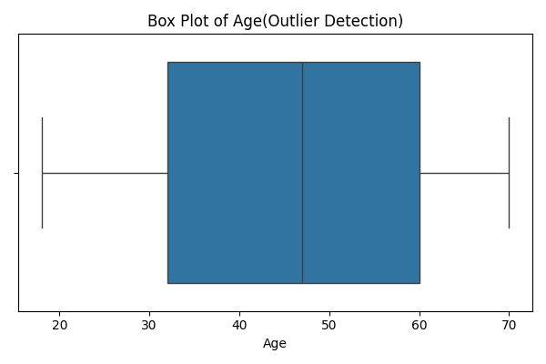
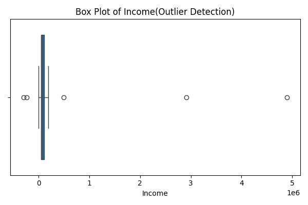
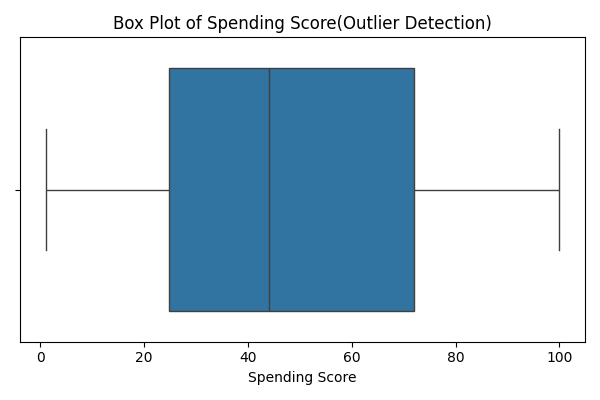

# Statistical Analysis & Customer Purchase Prediction Using Python

**Python | Pandas | NumPy | SciPy | Matplotlib | Seaborn | Scikit-learn | Data Cleaning | Statistical Testing | Logistic Regression**

## Project Overview

This project explores two complementary parts of a data science workflow: understanding the statistical distribution of simulated banking sales data, and building a classification model to predict customer purchasing behaviour. The work was completed as part of my MSc Data Science studies.

**Part 1 — Statistical distribution analysis:** Generate a reproducible synthetic dataset of monthly loan sales for 100 bank branches, explore its characteristics, visualise its distribution, and test whether it is consistent with a normal distribution.

**Part 2 — Applied predictive modelling:** Prepare a customer dataset with missing and inconsistent values, identify potential outliers, and train a logistic regression classifier to predict whether a customer makes a purchase.

The goal was to demonstrate how data quality checks, statistical reasoning, visualisation, and supervised learning fit together in practical analytical work.

## Key Results at a Glance

| Area | Result |
|---|---|
| Simulated bank branches | 100 |
| Mean simulated monthly loan sales | 503,203.29 (synthetic units) |
| Shapiro–Wilk normality test | W = 0.9805, p = 0.1460 |
| Customer records before cleaning | 200 |
| Initial missing values | Age: 97; Income: 112; Gender: 55 |
| Income outliers identified by IQR | 5 |
| Model | Logistic Regression |
| Train/test split | 80% / 20% (160 / 40 records) |
| Test accuracy | **57.5%** |
| Purchase-class (1) precision / recall / F1 | **0.64 / 0.35 / 0.45** |

> **Interpretation:** The simulated loan-sales observations did not provide sufficient evidence to reject the normality assumption at the 5% significance level. The purchase model demonstrated a complete baseline classification pipeline, but its predictive performance was modest and it missed a substantial proportion of actual purchasers.

## Tools and Techniques

- **Python, Pandas and NumPy:** data ingestion, data preparation, summary statistics and feature handling
- **SciPy:** skewness, kurtosis, Q–Q analysis and Shapiro–Wilk hypothesis testing
- **Matplotlib and Seaborn:** distribution plots and outlier visualisation
- **Scikit-learn:** train/test splitting, logistic regression, class predictions, probabilities and classification metrics
- **Excel:** source format for the customer dataset (`customers.xlsx`)

## Part 1 — Statistical Distribution Analysis

**Source:** `Task1_statisticaldistribution.py`

A synthetic dataset of 100 bank branches was generated with NumPy using a fixed random seed (`50`) and a normal sampling process with a specified mean of 500,000 and standard deviation of 80,000. The generated values are **simulated**, not actual bank loan-sales records.

### Approach

1. Generate branch-level monthly sales observations.
2. Calculate the mean, median, standard deviation, skewness and kurtosis.
3. Examine the histogram and fitted normal density curve.
4. Inspect potential unusual values with a box plot and deviations from normality with a Q–Q plot.
5. Apply the **Shapiro–Wilk test** to assess normality.

### Findings

| Statistic | Observed value |
|---|---:|
| Mean | 503,203.29 |
| Median | 503,620.55 |
| Standard deviation | 86,536.00 |
| Skewness | -0.25 |
| Kurtosis (Pearson definition) | 4.42 |
| Shapiro–Wilk W | 0.9805 |
| Shapiro–Wilk p-value | 0.1460 |

For the Shapiro–Wilk test, the null hypothesis is that the observations come from a normal distribution. Because **p = 0.1460 > 0.05**, the analysis **failed to reject** that null hypothesis. This does not prove perfect normality; the plots also show some extreme observations and tail deviations.

### Visualisations

**Histogram with normal density curve**


The histogram compares the generated observations against a fitted normal density curve and marks the sample mean and median.

**Box plot of monthly loan sales**


The box plot highlights the spread of values and potential extreme observations.

**Normal Q–Q plot**


The Q–Q plot checks how closely sample quantiles follow the theoretical normal distribution.

## Part 2 — Customer Data Preparation & Purchase Prediction

**Source:** `Task2_AppliedModelling.py`  
**Dataset:** `customers.xlsx`

### Objective

Build a binary classifier for `Purchased` (0 = no purchase, 1 = purchase) using four customer attributes:

- `Gender`
- `Age`
- `Income`
- `SpendingScore`

The input file contains **200 customer records**. `CustomerID` was excluded from the model because it is an identifier rather than a meaningful predictive feature.

### Data Cleaning and Preprocessing

The original dataset required several cleaning steps before modelling:

| Data-quality issue | Treatment implemented |
|---|---|
| Blank and missing values | Standardised blanks as missing data |
| Inconsistent gender labels (`M`, `F`, `Male`, `Female`) | Standardised category labels |
| Missing age and income values | Median imputation |
| Missing gender values | Filled with an `Unknown` category |
| Extreme numeric values | IQR-based capping (winsorisation to 1.5×IQR bounds) |
| Duplicate records | Checked and removed exact duplicates, if present |
| Categorical gender values | Encoded as numeric categories |
| `CustomerID` | Dropped before model training |

**Initial missingness:** 97 age values, 112 income values and 55 gender values were missing. The IQR procedure detected **five income outliers**; no age or spending-score outliers were detected by that rule. After the cleaning steps, the modelling features contained no missing values.

### Outlier Visualisations

| Age | Income | Spending Score |
|---|---|---|
|  |  |  |

These plots were generated **before** outlier capping. In particular, the income distribution contains several unusually large values, making outlier handling relevant to model preparation.

### Model Development

The project uses **Logistic Regression** from Scikit-learn to predict the binary purchase outcome. Data was divided into an **80% training set and 20% test set**, using `random_state=50` for a reproducible split. The classifier was fitted with `max_iter=1000` and evaluated on the held-out test set.

The script also generates example predictions and purchase probabilities for two hypothetical customer profiles, demonstrating how the model could be used for individual scoring. These are **illustrative model outputs**, not validated business decisions.

### Model Evaluation

| Metric | Not purchased (0) | Purchased (1) |
|---|---:|---:|
| Precision | 0.55 | 0.64 |
| Recall | 0.80 | 0.35 |
| F1-score | 0.65 | 0.45 |
| Support | 20 | 20 |

**Overall test accuracy: 57.5% (23 of 40 test observations correctly classified).**

**Confusion matrix** (rows = actual class; columns = predicted class):

| | Predicted 0 | Predicted 1 |
|---|---:|---:|
| Actual 0 | 16 | 4 |
| Actual 1 | 13 | 7 |

The model correctly classified 16 non-purchasers and 7 purchasers, but misclassified **13 actual purchasers** as non-purchasers. The low recall for the purchase class (0.35) is an important limitation if the aim is to identify prospective buyers. This is a **baseline model**, not a production-ready predictor.

## Key Learning Outcomes

- Generated reproducible synthetic data and evaluated distributional assumptions rather than assuming normality.
- Used exploratory plots alongside formal hypothesis testing to interpret statistical results.
- Cleaned a customer dataset with missingness, inconsistent categories and extreme income values.
- Built and evaluated an end-to-end supervised classification workflow.
- Interpreted precision, recall, F1-score and the confusion matrix instead of relying on accuracy alone.
- Identified concrete improvements needed before predictive results could support real business decisions.

## Limitations & Future Improvements

1. **Substantial missingness:** Almost half of age entries and over half of income entries were missing. Median imputation is simple and reproducible, but it may obscure useful variation or introduce bias.
2. **Preprocessing before data splitting:** The original implementation calculates imputation values and outlier thresholds using the full dataset before the train/test split. A future version should fit preprocessing **on training data only**, ideally through a Scikit-learn `Pipeline` and `ColumnTransformer`, to avoid data leakage.
3. **Feature representation and scaling:** Gender categories are encoded as integers, and the numeric variables have different scales. One-hot encoding for categories and appropriate numeric scaling would be worth testing.
4. **Model quality:** At 57.5% accuracy and 35% recall for purchasers, the current classifier is only a starting point. Compare against a majority-class baseline, use stratified cross-validation, inspect class balance, tune the decision threshold and evaluate ROC-AUC / precision–recall metrics.
5. **Synthetic loan-sales data:** Findings from Part 1 describe simulated data only and should not be generalised to real banking performance.
6. **Fairness and responsible use:** Customer segmentation and prediction should be assessed for privacy, representativeness and group fairness before any real-world targeting decisions.


## How to Run

**1. Clone the repository** and navigate to the project folder.

**2. Install the required packages:**

```bash
python -m pip install numpy pandas scipy matplotlib seaborn scikit-learn openpyxl
```

**3. Run the statistical distribution analysis:**

```bash
python Task1_statisticaldistribution.py
```

This generates a fresh synthetic dataset using a fixed seed, prints descriptive statistics and the Shapiro–Wilk test result, and displays three plots.

**4. Run the customer prediction workflow:**

```bash
python Task2_AppliedModelling.py
```

Keep `customers.xlsx` in the same directory as the Python scripts. This script prints data-quality checks, fits a logistic regression model, reports evaluation metrics and sample predictions, and writes the three customer-variable box plots into the project directory.

> **Note:** The three images in Part 1 are provided as repository assets; the original Part 1 script displays its plots using `plt.show()` rather than saving them automatically. Both scripts are written for local Python execution.

## Project Context

Developed during my **MSc Data Science** studies as a statistical programming and applied modelling project. The emphasis was on transparent methodology, reproducible results and critical evaluation of a baseline machine learning model.

